# BillboardOS

**The operating system for autonomous outdoor advertising.**

BillboardOS is a Cal Hacks 13.0 hackathon project: a network of AI-assisted digital billboards that understand local audience activity, price available ad slots, match advertisers, negotiate proposals, handle payments, schedule creatives and reconcile delivery.

> **Status:** Working build in progress. Booking core, operator console, billboard player, x402 payment server and the finance (AR + collections) core run today. See [what's real and what's simulated](#whats-real-and-whats-simulated).

## Documentation hub

**[Open the documentation index](docs/index.md)** · [Competition guide](docs/competition/index.md) · [All sponsor tracks](docs/competition/sponsor-tracks.md) · [Original guide: extracted text](docs/competition/official-guide-text.md) · [Product vision](docs/product/vision.md) · [System architecture](docs/architecture/overview.md) · [MVP roadmap](docs/development/roadmap.md)

| Focus | Documentation |
|---|---|
| Original hackathon rules | [Event guide summary](docs/competition/index.md) · [extracted source text](docs/competition/official-guide-text.md) |
| All sponsor tracks & prize references | [Sponsor catalog](docs/competition/sponsor-tracks.md) |
| Target sponsors and eligibility plan | [Track strategy](docs/competition/track-strategy.md) |
| Original project brainstorm | [Ideation](docs/notes/ideation.md) · [original text](references/original/pasted.txt) |
| Product requirements | [Vision](docs/product/vision.md) · [MVP acceptance tests](docs/product/requirements.md) |
| Engineering | [Overview](docs/architecture/overview.md) · [Agents](docs/architecture/agents.md) · [Payments & risk](docs/architecture/payments-and-risk.md) · [Data model](docs/architecture/data-model.md) |
| Team execution | [Setup](docs/development/getting-started.md) · [Roadmap](docs/development/roadmap.md) · [Demo](docs/demo/judging.md) |
| CREAO agents and API rehearsal | [Saved Sales + Revenue rehearsal](agents/creao/README.md); [four new pipeline agent prompts and setup](agents/creao/live/README.md) |

## How it works

```mermaid
flowchart LR
    Buyer[Advertiser or buyer agent] --> Brief[Campaign brief]
    Brief --> Match[Inventory + audience matching]
    Match --> Quote[Pricing + negotiation]
    Quote --> Hold[Exclusive slot hold]
    Hold --> Verify[x402 payment verification]
    Verify --> Book[Booking + creative approval]
    Book --> Display[Physical billboard]
    Display --> Audit[Playback and revenue audit]
```



## Development

Requires Node 22+.

```bash
git clone https://github.com/PhongCT1105/BillboardOS.git
cd BillboardOS
npm install
cp .env.example .env            # fill in keys; see the comments in the file

npx convex login                # once
npm run dev:convex              # Convex dev deployment (writes .env.local)
npm run seed                    # billboard, slots, advertisers, campaigns, conference event, Nvidia campaign
npx convex run seed:finance     # invoices + bank feed with planted errors
npx convex run seed:liveVenue   # dev only: seeds demo companies in a separate workspace (plus a screen, slots and a seeded event); never on production

npm run dev                     # web app at http://localhost:5173 (payments and seller agents run on Convex)
npm run deploy:web              # serve the built site from the Convex deployment at https://<deployment>.convex.site
npx convex run seed:demoAgentKeys  # prints demo agent keys once; put them in .env
# Developer tools, outside the demo path (real x402 from a laptop; they use seed:demoAgentKeys)
npm run buyer -- --hold-only    # advertiser buying agent (pays when CDP wallet is funded)
npm run a2a:demo                # Nvidia's agent buys a report from the host's seller agent, negotiates, pays over x402
npm run webhook:listen          # local receiver for signed watch-rule alerts (needs a public tunnel URL)

npm test                        # convex-test suite

# Demo rehearsal
npx convex run seed:resetFinanceDemo                    # bank feed back to 7 unmatched planted lines
npx convex run seed:resetBookingDemo                    # release active holds, top up slots
npx convex run seed:addScenarioBankLine '{"payerName":"HARBOR DENTAL GRP","amountMinor":20000,"memo":"judge test"}'
npm run typecheck               # web, convex and server
```

| URL | What it is |
|---|---|
| `#/console` | Operator console: inventory, revenue, exceptions, creative approvals, activity |
| `#/finance` | AR clerk and collections: bank feed, reconciliation, approvals, receivables |
| `#/book` | Advertiser booking: quote, hold, creative upload |
| `#/player/<billboardId>` | Fullscreen billboard screen. Add `?camera=1` to count people with the device camera. Shows announce, live auction, negotiation, settling and playing |
| `#/customer/agent` | Advertiser: set up the company agent, its wallet, limits and live feed |
| `#/moment` | Presenter: devices, queue, live bids, host pricing and event, company top-ups |

Running the live auction on a real deployment: [production runbook](docs/demo/live-moment-runbook.md). Production seeds nothing: the host creates the screens by hand and real companies sign up.

The x402 payment endpoints, seller agents (`/a2a/hosts/<workspaceId>/...`) and the agent API (`/api/agent/...`) are served by Convex at `https://<deployment>.convex.site`. Payments need `CDP_API_KEY_ID`, `CDP_API_KEY_SECRET` and `X402_PAY_TO` (or `CDP_WALLET_SECRET`) set with `npx convex env set`. For the live auction, leave `X402_PAY_TO` empty or set it to the operator CDP account's address (`npx convex run companyAgentsNode:operatorWallet` prints it): winners pay `X402_PAY_TO`, and host top-ups send from the operator account, so the two must be the same wallet for money to recycle.

**Operator accounts.** The console, Finance and Sensor pages need an operator sign-in; booking and the screen are public. The **first account created on a deployment becomes the operator**. Teammates create an account, then an operator grants them with `operators.grant` (by email). Demoing separation of duties on operator-filed requests needs two operator accounts; agent-filed requests (for example `agent:ar` refunds) can be approved by any operator.

Convex reads its own environment, not `.env`: push server-side keys with `npx convex env set NAME value`.

For buyer negotiation turns, set `BITDEER_API_KEY` on the Convex deployment to use Bitdeer Model Studio (`zai-org/GLM-5.3-Flash` by default). `BITDEER_MODEL` can select another Model Studio text model. A missing key, slow response, or invalid answer uses the built-in bidding rules. The three background research/review jobs use CREAO when their new agent IDs and scoped keys are configured; otherwise the current Claude/rules path remains available. [Create and connect the agents](agents/creao/live/README.md).

Docs site (optional): `pip install -r requirements-docs.txt && mkdocs serve`.

## What's real and what's simulated

| Component | Status |
|---|---|
| Slot inventory, quotes, exclusive holds, hold expiry, bookings | **Real** (Convex transactions, 69 tests) |
| Staged pricing (crowd, time, event, scarcity, market history) with floor and ceiling | **Real**; the conference event is **seeded** |
| Company-specific pricing | **Real** guardrails; company assessment by **CREAO** when the new role is configured, otherwise Claude with web search or a labeled heuristic |
| Ascending auctions, proxy bidding, soft close, winner default (booking auctions) | **Real** (Convex) |
| Live auction: announce on real camera counts, 2 s join window, 12 s bidding (two 3 s extensions), negotiation, award, queue and re-offers | **Real** (Convex); the participants are real companies' agents |
| Live price: audience x plays x CPM x match, host minimum and host-set CPM | **Real**; the host sets CPM and minimum, and enters the event. Only the dev-only `seed:liveVenue` adds a **seeded** event |
| Company agents: one per advertiser, run on the server with their own CDP wallet, rule-based tactics, webhooks signed and verified | **Real**; wallets hold **testnet** USDC |
| Buyer negotiation model | **Bitdeer Model Studio code wired** for offer and counter decisions when `BITDEER_API_KEY` is configured; otherwise deterministic rules. A live Bitdeer run still needs to be verified. |
| Wallet funding | **Real**: the host's top-ups transfer USDC from the operator wallet; an advertiser's own top-up claims from the CDP faucet (1 USDC per claim, 10 USDC per rolling 24 h per project); testnet money only |
| Operator console, billboard player, playback receipts | **Real** |
| x402 checkout (402 challenge, verify, settle, record) | **Real code on Base Sepolia testnet**; paid run needs a funded CDP wallet |
| Agent-to-agent commerce: seller agent per host, paid audience reports, negotiation, x402 to the host's wallet | **Real** protocol and policies; `npm run a2a:demo` is a **developer tool** (a scripted buyer on a laptop); paid runs need a funded wallet |
| Watch rules, alerts, signed agent webhooks | **Real** |
| Payment for a live-auction win | **Real** x402 on Base Sepolia by the winner's agent; shown as paid only with a settlement transaction hash. There is no manual or rehearsal payment |
| Invoices, reconciliation, approvals, collections planning | **Real logic** on **simulated** fixture data with planted errors and an answer key |
| Bank feed | **Simulated** fixture today; Capital One Nessie sandbox next |
| Audience counts | **Real** on-device person detection (MediaPipe) on the display with `?camera=1`, sending aggregate counts only. There is no simulated crowd |
| Operator sign-in and approvals by identity | **Real** (Convex Auth, email + password) |
| CREAO Sales + Revenue agents | **Saved on CREAO**; operator console has a simulated Sales → Revenue → Sales rehearsal through server-side Convex actions. Shared Convex CREAO credentials still need deployment configuration; [setup and status](agents/creao/README.md) |
| CREAO live pipeline roles | **Three code paths ready for credentials**; four [creation prompts](agents/creao/live/README.md) are in the repo. The strategy role has no live trigger yet. |
| CRS risk screening, Claude explanations | **Not built yet** |

## Key sponsor ambitions

- **Hyphenate** — auditable, bounded autonomous finance operations and recovery from booking/payment exceptions.
- **Coinbase x402** — compatible machine payment for a protected ad-booking endpoint.
- **Bitdeer Model Studio** — frequent, low-cost buyer decisions inside the live negotiation loop.
- **CRS** — meaningful sandbox verification/risk review, only if available APIs fit.
- **CREAO** — an autonomous, one-operator billboard company.
- **Microsoft / Convex / Visa** — production-minded agents, reactive shared state and commerce experience, as applicable.

Sponsorship-track eligibility requires actual adherence to each sponsor's rules and proof during the demo. We do **not** claim existing integrations.

## Company knowledge pipeline (development)

The ten simulated sponsor advertisers have curated profiles and three dated, cited public-source passages each. Their campaign budgets, wallets, bids and payments remain simulated. The company context feeds the new CREAO Company Research role when configured. CREAO is not in the live buyer bidding window.

After the sponsor advertisers exist on the **development** deployment:

```sh
npx convex run companyKnowledge:seedSponsors
npx convex run companyKnowledgeEmbedding:indexMissing '{"limit":16}'
```

Set `BITDEER_API_KEY` on that deployment to index passages with `BAAI/bge-m3` (1024 dimensions). Run the indexer again until `remaining` is zero; a missing key returns `missing_key` while the cited profiles remain readable. `companyKnowledgeSearch:search` accepts `{"query":"voice agents","limit":5}` and optionally an `advertiserId`. `companyKnowledgeSearch:agentContext` accepts an advertiser ID and a question, returning a bounded profile and citations. These are internal Convex functions for operator use; no CREAO workspace credentials are needed yet.

## Provenance and privacy

Official competition text extracted from the uploaded Cal Hacks guide is provided for reference; the unmodified PDF should be retained separately and consulted for full rules. Team brainstorm text is tracked in `references/original/`. Uploaded images and the ~17-minute recording have **not been committed or transcribed**. Do not publish team audio without permission.

See [source register](docs/competition/sources.md).
