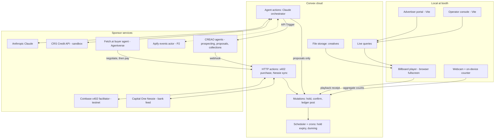

# ADR 0002 — Sponsor-native stack

**Date:** 2026-10-24  
**Status:** Proposed for team approval  
**Sources:** [Official guide] printed pp. 10–21 ([extracted text](../competition/official-guide-text.md)); `docs/original/CalHacks_Hyphenate_Track.pdf`; `docs/original/Idea.pdf` (unified design v2.0, not official).

## Context

The earlier docs left the backend open ("TypeScript API plus Postgres, or Convex if track chosen"). Generic defaults such as Supabase, Vercel or Stripe work, but they earn no sponsor track. Several sponsors offer tools that fill the same layers in our architecture.

We still keep one constraint: **a sponsor tool is only in the design if it sits on the critical path of the demo loop.** The guide explicitly penalizes bolt-ons. Factory scores "a chatbot wrapper with Droid added on" poorly. Bright Data disqualifies projects that mention it "only in the README". CRS scores "how central CRS data is to the product, not a bolt-on".

## Decision

Replace each generic infrastructure choice with a sponsor tool that does real work in that layer.

| Layer | Generic default | Sponsor replacement | What it does in BillboardOS | Track(s) |
|---|---|---|---|---|
| Database, realtime, server functions, file storage | Supabase / Postgres + Vercel functions | **Convex** | Slot hold is a single Convex mutation. Mutations are serializable transactions, so two buyers can't hold the same slot (P0-05) without custom locking. `scheduler.runAfter` expires holds. Crons run collections (dunning). File storage holds creatives. Live queries push to the operator dashboard **and** the billboard player, so the player subscribes to its schedule instead of polling. | Convex ($5,000) |
| Agent-paid checkout | Stripe | **Coinbase x402** (testnet) | `POST /purchases/:holdId` returns HTTP 402 with payment terms; the buyer agent pays from a test wallet; the server verifies through a facilitator before the booking mutation runs. Implement as a small Express server with `@x402/express` (the official seller SDK, Node 22+) that verifies, calls the Convex booking mutation, then settles ([details](../sponsors/coinbase-x402.md)). | Coinbase **Payment Agents** (one primary track only) |
| Bank feed for invoiced advertisers | Stripe / hand-made CSV | **Capital One Nessie** | Advertisers on invoice terms pay by deposit into the operator's Nessie account. Planted short, late and bundled payments create the "bank vs ledger vs contract" disagreement that Hyphenate asks for. The AR agent matches Nessie deposits to Convex ledger entries. | Capital One Nessie; strengthens Hyphenate "Is it real enough?" |
| Advertiser risk | None / mock | **CRS Credit API** (business credit + identity verification, REST) | During onboarding the risk agent queries a supplied test identity. The result sets **payment terms**: prepay via x402, net-15 invoice (paid through Nessie), or operator review. CRS changes how money flows, not just a badge on the UI. The CRS MCP server is described as a developer aid, so the agent calls the REST API ([details](../sponsors/crs.md)). | CRS Best Overall + Best Financial AI Agent |
| Agent reasoning | Any LLM | **Claude (Anthropic API)** | Orchestrator, brief parsing, negotiation turns, AR exception explanations. Pricing numbers still come from the deterministic pricing function. | Anthropic (needs a *named community*; see below) |
| Slow, asynchronous agent seats (prospecting, proposals, collections) | Claude in the same process | **CREAO agents on agent.creao.ai**, started from Convex via the API Trigger, results returned by webhook | One saved agent per role, forming the one-operator org chart. CREAO runs take minutes, so they never sit on the booking path ([details](../sponsors/creao.md)). | CREAO Best One-Person Company |
| Advertiser buying agent | Same process as seller | **Fetch.ai uAgent on Agentverse** | The advertiser's agent runs as a separate agent belonging to a separate company. It discovers the BillboardOS seller agent, negotiates within its budget cap, then pays through x402. This makes agent-to-agent commerce cross-organisational instead of two prompts in one process. **Eligibility requires the primary user workflow to run entirely inside an ASI:One conversation**, plus Chat Protocol and a 3–5 minute video ([details](../sponsors/fetch-ai.md)). | Fetch.ai |
| Event-aware pricing signal (P2) | Hard-coded events | **Apify** actor for public local event listings | The audience agent uses events near the screen as a labeled demand input to the pricing function. | Apify |
| Frontend hosting | Vercel | **None needed for the demo** | Run the Vite web app and the player locally at the booth (survives venue Wi-Fi drops); the backend lives in Convex cloud. If we want a deployed URL for the Microsoft "path to production" story, use Azure Static Web Apps. | Microsoft judges production-mindedness, not Azure usage |
| Edge sensing | — | Logitech webcam / Raspberry Pi from MLH lab or rental booth | On-device people counting; only aggregate counts leave the device. | General: Best Hardware |

**Hyphenate is a track, not a tool.** The seats are the **accounts receivable clerk** (applies x402 and Nessie payments to bookings) and the **collections specialist** (chases late invoices on a Convex cron). A human **controller** approves refunds and write-offs. Segregation of duties: the agent that requests a refund can't approve it.

**Anthropic needs a named community.** Proposal: "independent owners of 1–20 digital screens in San Francisco who can't afford a sales and billing team". Confirm with the team.

**Implementation update (2026-10-24):** The repeated buyer offer and counter decisions now call Bitdeer Model Studio's `zai-org/GLM-5.3-Flash` when configured. Claude remains on deeper company research and creative review. Convex still enforces bid and wallet limits and uses local rules if the Bitdeer call fails. A live Model Studio run has not yet been verified.

## Revised component map

The rule from [overview](../architecture/overview.md) is unchanged: agents run as Convex actions and can only *propose*; mutations enforce floors, holds, payment proof and approvals.

## The Hyphenate moment, revised

Two sources disagree within one demo run:

1. A Fetch.ai buyer agent pays via x402 for a hold that expired seconds earlier because a second buyer took the slot. Convex rejects the booking; the AR agent records an unapplied cash receipt and opens a refund request, which the controller must approve.
2. A Nessie deposit from an invoiced advertiser is $40 short and covers two invoices at once. The AR agent splits it, applies it, flags the shortfall against the contract terms, and the collections agent schedules a follow-up.

The operator console shows *expected vs observed vs difference*, the evidence (x402 receipt, Nessie transaction ID, contract), and the bounded next action. Plant these errors in seed data with an **answer key** — Hyphenate asks for "planted errors with an answer key" as proof.

## Tracks deliberately not targeted

| Track | Reason |
|---|---|
| SpacetimeDB | Same layer as Convex; using both would make one of them a bolt-on. Convex fits better (TypeScript, workflows, file storage, bigger prize). |
| Bright Data | The demo is disqualified if it shows any mocked or hardcoded data. Too risky for a pricing input at a venue. Apify covers the same need. |
| Cartesia | Voice must be core to the product; it isn't here. |
| SpaceXAI | Requires Cursor + Grok and a space-data theme. |
| Meta, Visa | Human connection / consumer shopping don't match an ad-ops finance product. |
| Moss, Elastic | Convex search covers retrieval; Elastic's criteria weren't published in the guide. |
| Factory Droid SDK | P3 only. Qualifies only if Droid gets a real triggered job (e.g., investigating a failed-playback exception, with visible plan and steps). Otherwise it reads as a bolt-on. |
| Bitdeer Model Studio | Optional. Only if it takes one bounded seat (e.g., creative moderation) without forking the model layer. |
| Notability, Mana, Figma | Process tracks. Notability is cheap if someone is already keeping notes. |
| Atlassian | Criteria are truncated in the guide. |

## Build order

1. Convex schema + hold/confirm mutations + hold-expiry scheduler (proves P0-05 and P0-06 with no sponsors).
2. Player and console on live queries.
3. x402 purchase endpoint on testnet.
4. CRS risk agent setting payment terms.
5. Nessie bank sync + AR/collections agents + planted errors.
6. Fetch.ai buyer agent.
7. Apify events (P2).

Each sponsor sits behind an adapter with a labeled fallback, so an outage can't corrupt booking state (see [requirements](../product/requirements.md) non-functional rules).

## Consequences

**Pros:** Every infrastructure layer is a sponsor tool doing core work. The architecture gives up no safety property, because Convex transactions are a stronger fit for atomic holds than a hand-rolled Postgres lock. One more source of truth (Nessie) makes the finance story more realistic.

**Cons:** More integrations means more failure points during a 2-minute demo. The team has to learn Convex. The x402 endpoint needs a small Express server next to Convex. Nessie is a mock bank and must be labeled **simulated** in the real-vs-simulated table.

## Verify before committing

- [ ] Whether Devpost limits how many sponsor tracks one project can enter (check the live site).
- [ ] Which Coinbase MCP satisfies "use the Coinbase MCP for Agents", and which team members meet Coinbase eligibility (US/Canada, 18+, verified account).
- [ ] Which business-credit test entities the CRS Postman collection includes.
- [ ] Whether the Fetch.ai "entirely inside ASI:One" rule is worth the extra flow (see [Fetch.ai](../sponsors/fetch-ai.md)).
- [ ] CREAO Tech Stack tab (API Trigger and webhook format) and whether one project can enter several CREAO tracks.
- [ ] Nessie API key access for the team.
