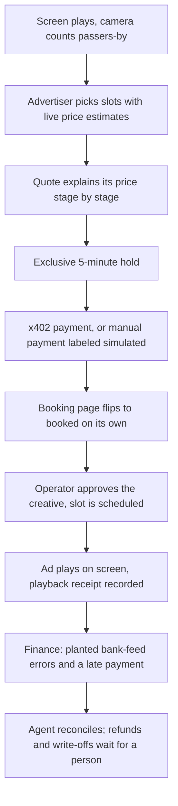

# Live judging and demo

The official Hacker Guide requires a live demonstration, recommends ~2 minutes, and says judges will be at assigned tables **Sunday 10:30 AM–12:30 PM**, after Devpost submission **by 9:00 AM** (printed pp. 7–8).

## Demo storyline — operator runs a billboard business

## Before judges arrive

- **Terminals:** `npm run dev:convex`, `npm run dev`, and `npm run server` if the CDP wallet is funded.
- **Reset:** `npx convex run seed:resetBookingDemo` and `npx convex run seed:resetFinanceDemo`.
- **Operator:** sign in on `#/console`. Teammates who create accounts get access from **Console → Operators**.
- **Tabs:**
  1. `#/player/<billboardId>` full screen on the monitor (the billboard). Get the id from `npx convex run billboards:list`.
  2. `#/sensor/<billboardId>` with the camera allowed (counts only, nothing stored).
  3. `#/book` (the advertiser).
  4. `#/console`.
  5. `#/finance`.

## Two-minute script

- **0–15s, the network.** "This screen is a billboard. The camera counts people walking past, on the device; only the count leaves. One operator runs the whole network." Point at the player and the sensor tab.
- **15–40s, pricing.** On `#/book`, pick two slots. Each shows a live estimate (~$). Click **Get exact price**, open **Why this price**: crowd, time of day, nearby event, scarcity, recent sales, each with a reason.
- **40–70s, hold and pay.** Click **Hold these slots**. Show the countdown, the exact USDC amount, Base Sepolia test funds, and the x402 payment request an agent can pay. Pay it:
  - funded wallet: an x402 client pays the request, and the receipt links to BaseScan;
  - otherwise: in the console, record the **manual payment** and say out loud that it is simulated (the audit log labels it).

  The booking tab switches to **You're booked** without a refresh.
- **70–95s, on air.** In the console, approve the creative. The slot is scheduled automatically and the screen plays the ad when the slot starts; the player records a playback receipt.
- **95–120s, the money.** On `#/finance`, run reconciliation over the bank feed: the AR agent matches clean lines, flags short and unidentified payments, and files refund or write-off requests it is not allowed to approve. Approve one in the queue; the activity log shows the agent asked and you decided.

**Main beat (live auction):** follow the [live moment runbook](live-moment-runbook.md): real camera counts, two companies' agents bidding with their own wallets, x402 payment, the ad plays.

## 'The moment' for Hyphenate

Two buyers want the same slot: the hold makes the second one wait, and a contested slot goes to auction instead of a race. A payment that arrives after its hold ran out is recorded but never booked; the buyer sees "under review" and the operator sees an exception with the amount, evidence and next step. Agents can request refunds and write-offs but never approve them, and nobody approves their own request. Judges see agents doing **real work** under controls, not chatting about work.

## Exhibit board: real vs simulated

| Component | Status | What to show |
|---|---|---|
| Quotes, holds, bookings, hold expiry | **Real** (Convex transactions, test suite) | The booking flow |
| Staged pricing | **Real**; the nearby event is **seeded** | "Why this price" |
| Camera people count | **Real** on-device detection, aggregate counts only; labeled simulated fallback | Sensor tab |
| Coinbase x402 | **Real code on Base Sepolia**; a paid run needs a funded CDP wallet | Receipt with BaseScan link |
| Manual payment | **Simulated**, labeled "MANUAL (simulated)" in the audit log | Say it out loud |
| Live auction | **Real**; company agents run on the server with their own testnet wallets | [Runbook](live-moment-runbook.md) |
| Finance (AR, reconciliation, approvals) | **Real logic** on **simulated** fixture data with planted errors | Finance page |
| Company pricing | Claude with web search when `ANTHROPIC_API_KEY` is set, otherwise a labeled heuristic | Valuation list on the finance page |
| Screen playback and receipts | **Real** | Player tab |
| CRS, CREAO agents, Claude explanations | **Not built** | Don't claim them |

## Final checklist

- [ ] Devpost entry and team members added.
- [ ] Project implementation began during event, consistent with official rules.
- [ ] Clear README with setup, real integrations, limitations and safety.
- [ ] No keys in repository or screen capture.
- [ ] Venue/network failsafe and reproducible local demo.
- [ ] Every sponsor claimed has evidence.
- [ ] Team stays at judging table for full window.
