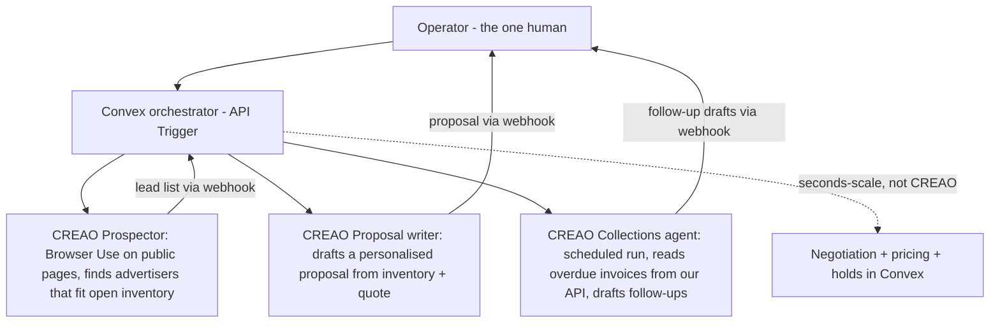

# CREAO

| | |
|---|---|
| **Type** | **Tool required.** At least one CREAO agent must do the core work. |
| **Tracks** | Best AI-First Disruptor ($2,500) · Best One-Person Company ($1,500) · Best Team Empowerment ($1,000) |
| **Our target** | **Best One-Person Company** (P1, decided 2026-10-24) |
| **Rules status** | Home tab captured 2026-10-24. **Tech Stack, Schedule and About tabs not captured yet.** |
| **Sources** | [CREAO Cal Hacks page](https://community.creao.ai/CalHacks2026) · screenshots in `docs/original/creao/` · [Official guide] printed pp. 11–12 |

## The one requirement

> At least one CREAO agent does the core work of your project.
>
> 1. Build that agent on agent.creao.ai. You can use more than one.
> 2. In your Devpost README, include a share link to one of the agent's runs and the agent ID (shown on its page).
> 3. Show the agent running in your demo.
>
> That's the whole rule. How you use CREAO beyond it is up to you.

## Tracks

"One rule for every track: a CREAO agent does the core work. **Pick the track that fits.**" That wording suggests one CREAO track per project; confirm at the booth.

| Track | Prize | Question it asks | Win if | Build with |
|---|---|---|---|---|
| Best AI-First Disruptor | $2,500 | Remove the agent, and the product stops working. | Your app runs on the agent's output, end to end. | API Trigger + webhooks, connectors, Browser Use, your own tools |
| **Best One-Person Company** | $1,500 | One human operating like a funded startup. | You show an **org chart of agents that hand work to each other**. | One saved agent per role, coordinated by a scheduled `/workflow` (no code) or an orchestrator via API Trigger |
| Best Team Empowerment | $1,000 | Agents as the connective tissue between people. | Your agents make a team work better together without replacing anyone. | Slack, Teams or Notion connectors, scheduled runs, webhook handoffs |

**Prize on top of cash — CREAO Launchpad** for every winning team: 1 year of CREAO Pro Max ($1,440 value), product/technical/founder mentorship, a meet-and-greet with a founder or technical staff member, demo opportunities, launch support and amplification, and interview opportunities ("Yes, we're hiring").

## Judging criteria

| Weight | Criterion | What judges ask |
|---|---|---|
| 30% | AI as foundation | Remove the agent. Does the product stop working? |
| 25% | Depth on CREAO | What does the agent actually do? Did you extend it with your own tools, APIs, or agents, or call it from your product? **We check the links in your README.** |
| 20% | Originality and ambition | Is this a new kind of product, or a chatbot wrapper? |
| 15% | Track fit | Does it clearly answer the track's question? |
| 10% | Demo and storytelling | The live demo works, and the pitch names what CREAO is doing. |

## Platform constraints ("Know Before You Build")

These shape the architecture — read them before designing any CREAO call.

- **Runs take minutes.** Design for async work: show progress in your UI, and don't hold a request open waiting for a run. **There's no live token streaming on the API Trigger.**
- **Credits.** Every run spends credits. An orchestrator that starts many agents spends many runs. Watch your balance, and **don't let an agent start itself.** If you run out, message CREAO in the Discord channel or visit the booth for a top-up.
- **Keys stay on the server.** Never put a `capi_` key in browser, mobile, or public repo code. Call the API from your backend.
- **Sandboxes are per conversation.** Packages installed in chat last only for that conversation. Save them with **Create Agent** or **Update Environment** so every run has them. Saving happens in the agent.creao.ai interface; **the API only runs agents.**
- **Writes need permission.** An agent that posts, sends, or edits in a connected app follows the agent's write setting. Set it to run automatically if your product needs unattended writes.

## Hacker tips (from CREAO)

1. **Prototype in minutes.** Sign up with the hackathon link, build your agent by chatting, save it with Create Agent, and make your first API call the same hour.
2. **Choose run modes intentionally.** Use async runs with webhooks or polling for multi-step background work; keep your UI responsive while the agent works.
3. **Leverage multi-agent orchestration.** Coordinate specialized role agents through the API Trigger, with keys stored in Secrets and conversation continuity via `threadId`.
4. **Secure keys server-side.** Always proxy API requests through your backend.
5. **Answer the rubric question in your pitch.** Say out loud: "Remove the agent, and this product dies." Then prove it in the demo.

## Glossary of CREAO terms used above

| Term | Meaning (as far as the page shows) |
|---|---|
| agent.creao.ai | Where agents are built (by chatting) and saved |
| Create Agent / Update Environment | Save an agent and its installed packages so every run has them |
| API Trigger | HTTP API that starts a run of a saved agent; async, no streaming |
| Webhooks / polling | How your backend learns a run finished |
| `threadId` | Keeps conversation continuity across runs |
| Secrets | Where keys used by agents are stored |
| Connectors | Integrations with apps (Slack, Teams, Notion named) |
| Browser Use | Agent tool for browsing the web |
| `/workflow` | No-code scheduled coordination of saved agents |
| Write setting | Whether an agent's writes to connected apps need approval or run automatically |
| `capi_` key | CREAO API key; server-side only |

The exact API Trigger endpoint, request body and webhook payload are presumably on the **Tech Stack** tab, which we don't have yet.

## How BillboardOS fits (proposed)

**Track: Best One-Person Company.** It matches the original idea ("let one operator manage prospecting, sales, bookings, and billing across a billboard network") and the rubric asks for exactly what we have: an org chart of role agents handing work to each other.

Because runs take minutes, CREAO agents take the **asynchronous seats**, and the second-scale work stays in Convex (Bitdeer Model Studio for buyer negotiation turns when configured, deterministic code for pricing and holds):

Implementation rules:

- Start every run from a Convex action; the `capi_` key lives in Convex environment variables.
- Receive results on a Convex HTTP action (webhook) and store them; the operator console shows run progress through a live query.
- Give CREAO agents **our API as their own tool** (e.g., read open inventory, read overdue invoices). That's what "Depth on CREAO" rewards.
- No agent starts another agent on its own; the orchestrator caps runs per hour to protect credits.
- Keep outbound writes (emails, posts) on **approval** for first-contact outreach. That matches Hyphenate's "knowing when to ask". Use automatic writes only for internal handoffs.

**"Remove the agent" test:** without the CREAO agents there are no leads, no proposals and no collections. The one operator has no pipeline and no cash coming in. Prove it in the demo by showing the empty pipeline before a run.

**Demo timing risk:** a run takes minutes, but the pitch is 2 minutes. Start one run at the beginning of the demo and show a completed run (with its share link) while it works.

## Evidence checklist

- [ ] At least one agent built and saved on agent.creao.ai (ideally three: Prospector, Proposal writer, Collections).
- [ ] Devpost README contains a **run share link** and the **agent ID** for each agent.
- [ ] An org-chart diagram of the agents and their handoffs in the README and pitch.
- [ ] The agent runs live in the demo; the pitch names what CREAO does.
- [ ] Agents call at least one of our own APIs as a tool.
- [ ] No `capi_` key in the repo or browser code.

## Open questions

- [ ] Can one project enter more than one CREAO track?
- [ ] Capture the **Tech Stack** tab: API Trigger endpoint, auth header, request body, webhook payload, `threadId` usage.
- [ ] Capture the **Schedule** tab (workshop: "From Chat to Backend: Build an AI Agent You Can Call From Code").
- [ ] Hackathon sign-up link and starting credit balance.
- [ ] Which email/CRM connectors are available for the Collections agent.
